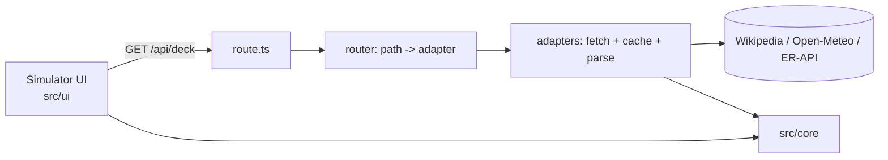

# Design: Revenant MVP

## Core (src/core, pure)
- `types.ts`: `Profile {id, cols, rows}`, `Link {label, href}`,
  `Card {id, title, lines: string[], links: Link[], input?: {name, action}}`,
  `Deck {path, cards: Card[], offline?: boolean, next?: string}`.
- `sanitize.ts`: `sanitize(unknown, maxLen)` -> string: non-strings -> "", strip tags/entities,
  control chars, collapse whitespace, cap length.
- `fit.ts`: `wrap(text, cols)` word-wraps; words longer than `cols` are hard-split with `-`.
  `paginate(title, text, profile)` -> `Card[]` with `rows-1` body rows per card.
- `budget.ts`: `bytes(x)` = UTF-8 length of `JSON.stringify(x)`;
  `buildDecks(path, cards)` packs cards into decks <= 1,400 B, appending a "More" link
  (`next`) when split; `assertCard` guarantees <= 1,000 B (re-paginates if needed).
- `menu.ts`: `menuCards(title, links, profile)`: link labels wrapped; overflow -> more cards.
- `t9.ts`: key map (2=abc ... 9=wxyz, 0=space, 1=punct). `encodeT9(text)` -> digits,
  `multitapEncode(text)` -> key presses with pause markers; `keypad` reducer:
  `(KeypadState, Key) -> KeypadState` for both modes. T9 decoding uses a small built-in
  word list plus fallback to first letters, cycled with `*`.
- `nav.ts`: `NavState {history: string[], deck, card, focus, text, keypad}`; reducer
  `navReduce(state, key)` -> `{state, effect?: {load: path} | {setProfile}}`. Pure; the UI
  performs effects. Back pops history (never below Home).

## Adapters (src/adapters)
- `parse/*.ts`: `parseWikiSearch`, `parseWikiArticle`, `parseWikiSummary(->Ask)`,
  `parseWeather`, `parseRates`: `(json: unknown, profile) -> Deck`. Defensive: type-check
  every field, sanitize every string, fall back to an "No data" card.
- `http.ts`: `getJson(url, ttlMs)`: fetch with `AbortSignal.timeout(5000)`, UA header,
  response size cap (1 MB), in-memory Map cache `{value, at}`; on failure returns stale
  with `stale: true` or throws.
- `router.ts`: `resolveDeck(path, profile)` -> `{deck, status}`. Static decks: home,
  settings, about. Paths: `/`, `/wiki`, `/wiki/search?q=`, `/wiki/a/:title?p=N`,
  `/weather`, `/weather/:city`, `/money`, `/ask`, `/ask/q?q=`, `/settings`, `/about`,
  `/about/:id`.
- Settings links use `set:profile=<id>`; nav reducer turns these into a setProfile effect.

## API
`GET /api/deck?path=&profile=` -> `200 {deck, bytes}` (bytes = deck JSON size).
Validates `path` (starts with `/`, <= 300 chars) and `profile` (known id, default nokia3310).
`Cache-Control: public, max-age=60`.

## UI (M2)
Single client component: phone shell, LCD (monospace, pixel look via CSS), softkeys,
5-way pad, keypad, keyboard handler, byte counter, loading/offline/error badges.
Profile stored in localStorage.

## Decisions
- One screen = one card (no in-card scrolling): simplest pagination model.
- Article decks hold a window of pages; "More" fetches the next deck (`?p=N`).
