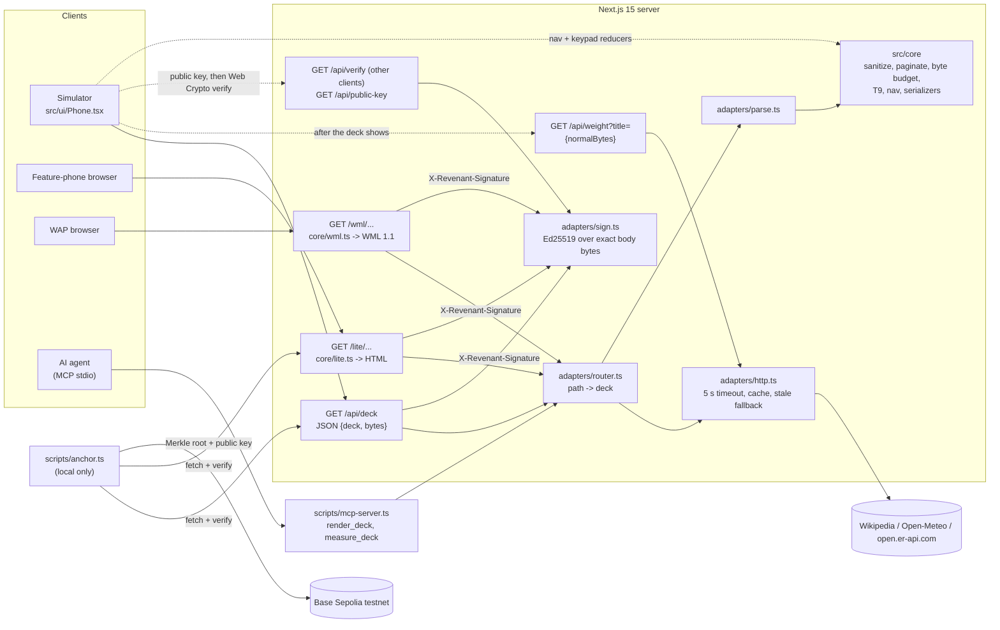

# Revenant

Revenant brings back WAP, the 1999 Wireless Application Protocol that served tiny text "decks of cards" to feature phones. A server-side transcoder turns today's web content (Wikipedia, weather, exchange rates) into small, cheap-to-load cards. It serves them three ways: a browser feature-phone simulator, a no-JavaScript HTML version for real feature-phone browsers, and real WML 1.1 for WAP browsers.

Built for Kiroween 2026 (Resurrection category).

## Who it's for

Feature-phone users in Uganda and East Africa who pay for data by the MB. Every screen in the simulator shows how many bytes the last deck cost.

## Features

1. **Wikipedia:** search with T9 or multitap typing, then read an article page by page. Article pages also show the size of the normal Wikipedia article HTML next to the deck size.
2. **Weather:** Open-Meteo current conditions and a 3-day forecast for Kampala, Gulu, Mbarara and Jinja.
3. **Money:** UGX per USD, EUR, GBP and KES, with an "as of" time.
4. **Ask:** type a question and get a 3-card answer from the top Wikipedia article summary, labeled with its source.
5. **Settings:** device profile, either Nokia 3310 (14x6 characters) or Generic (20x10).
6. **About:** attribution cards.

## Three ways to load Revenant

| URL | For | Format |
|-----|-----|--------|
| `/` | Any modern browser | Feature-phone simulator (React) over `GET /api/deck` (JSON) |
| `/lite` | Real feature-phone browsers (Opera Mini, KaiOS, old WebKit) | Server-rendered HTML with no JavaScript, images or CSS, usually under 3 KB. Keys 1-9 jump to numbered links and 0 goes Home. |
| `/wml` | Genuine WAP browsers | WML 1.1 (`text/vnd.wap.wml`): one `<card>` per screen, with links as `<a>` and searches as `<go method="get">` |

All three use the same router, adapters, core logic and byte budgets. For example, `/lite/wiki/a/Kampala` and `/wml/wiki/a/Kampala` serve the same deck as the simulator. Add `?pf=generic` to `/lite` or `/wml` URLs to use the 20x10 profile, or choose it on the Settings page.

## Architecture



`src/core` is pure logic with no fetch, React or Next imports, and ESLint enforces that. The WML and HTML serializers live in core and are property-tested.

## Run locally

Requires Node 24.x.

```sh
npm install
cp .env.example .env.local   # set REVENANT_CONTACT (sent in the Wikimedia User-Agent)
npm run dev                  # http://localhost:3000, /lite, /wml
```

Checks: `npm run typecheck && npm run lint && npm test && npm run build`.

Simulator keyboard: arrow keys for the 5-way pad, Enter = Select, Backspace/Escape = Back, and 0-9, `*`, `#` for the keypad. `#` toggles between T9 and multitap.

## Hosted

`<hosted URL here>`

## Signed cards

WAP 1.x had WTLS, a security layer between the phone and the gateway. Revenant revives the idea at the content level:

- **What is signed.** Every response from `/api/deck`, `/lite` and `/wml` carries `X-Revenant-Signature`, an Ed25519 signature (base64) over the exact response body bytes, plus `X-Revenant-Key-Id` (first 16 hex digits of the SHA-256 of the public key). The private key comes from the server-only env var `REVENANT_SIGNING_KEY`. Without it, responses say `X-Revenant-Signature: unsigned` and local dev still works. `npm run keys:generate` prints a new key pair to the terminal and writes no file.
- **Checking.** `GET /api/verify?body=...&sig=...` returns `{ valid, keyId, publicKey }`, or a small JSON error. `GET /api/public-key` serves `{ keyId, publicKey }` with a one-day cache. The simulator fetches the key once and checks each fresh deck in the browser with Web Crypto (`crypto.subtle.verify("Ed25519", ...)`) over the exact response bytes. Nothing is uploaded. The badge next to the byte counter reads "&#10004; signed", "&#10006; signature invalid", "signed (not checked)" when the browser lacks Ed25519, or "unsigned". Property tests check that flipping any byte of a signed deck fails verification and that hostile input to the verifier always returns JSON.
- **Anchor.** `npm run anchor -- <base URL>` runs only on your machine. It fetches three demo pages (`/`, `/lite`, `/wiki/a/Kampala`) and checks each signature through `/api/verify` and again locally. It then builds a SHA-256 Merkle root of the exact signed bodies and sends a zero-value Base Sepolia transaction to its own address with `revenant-anchor:v1;root=...;key=...` in the data field. The wallet key is read only from `ANCHOR_WALLET_KEY` in your shell. The result (root, leaf hashes, paths, signatures, tx hash, time, public key) goes to `anchors/latest.json`, which is committed and shown on **About > Proof** in the simulator, with a link to the transaction on sepolia.basescan.org.
- **What the anchor proves.** Pages whose bodies hash to those leaves existed, signed by that key, no later than the transaction's block time. Anyone can recompute the leaves and root from the saved bodies and compare them with the on-chain data.
- **What it does not prove.** It covers only that one snapshot. Weather, rates and Wikipedia change, so today's responses won't match the anchored hashes. Verify a saved copy, not a fresh fetch. It doesn't prove the content is true, only who signed it and when. It runs on testnet only, which carries no economic guarantee. Anyone holding the private key can sign, and `/api/verify` trusts only the server's current key.

## Use it from an AI agent

`scripts/mcp-server.ts` is a read-only stdio [MCP](https://modelcontextprotocol.io) server built on the same router, adapters and core as `/api/deck`. It has two tools:

- `render_deck(path, profile?)` returns the deck as plain-text cards plus its byte size.
- `measure_deck(path, profile?)` returns response bytes, deck bytes, card count, the largest card, and whether the card (1,000 B) and deck (1,400 B) budgets hold.

Invalid paths, unknown profiles and non-200 pages come back as MCP error results. There are no write tools and no secrets. Run it with `npm run --silent mcp` (`--silent` keeps npm's banner off stdout). Kiro config (`.kiro/settings/mcp.json`):

```json
{
  "mcpServers": {
    "revenant": {
      "command": "node",
      "args": ["C:\\dev\\revenant\\node_modules\\tsx\\dist\\cli.mjs", "--tsconfig", "C:\\dev\\revenant\\tsconfig.json", "C:\\dev\\revenant\\scripts\\mcp-server.ts"],
      "disabled": false,
      "autoApprove": ["render_deck", "measure_deck"]
    }
  }
}
```

The compact web is cheap for agents to read too. A Wikipedia article deck is about 1.3 KB, while the normal article HTML for Kampala is about 735 KB. These are byte counts only. Token savings have not been measured.

## Attribution

- Text from Wikipedia, CC BY-SA 4.0. Each article card shows its source title.
- Weather data by [Open-Meteo.com](https://open-meteo.com/), CC BY 4.0.
- Rates by [Exchange Rate API](https://www.exchangerate-api.com) (open.er-api.com).

## Limitations

- The byte counter shows the real uncompressed UTF-8 size of the response body. Bytes on the wire differ because of gzip/brotli, HTTP headers and TLS. Back-navigation served from the simulator's cache shows 0 B.
- `/wml` is standard WML 1.1 output, checked as well-formed XML by property tests. It has not been tested on physical WAP devices or through a WAP gateway. `/lite` has not been tested on physical phones either.
- The size comparison counts only the normal article's HTML document, with no images, scripts or CSS, so a real page load weighs more. The simulator requests it from `/api/weight` after the article deck is shown, so it never delays the deck. It shows "measuring..." until the size arrives (often a second or more, since Wikipedia's HTML runs to hundreds of KB) and shows nothing if the request fails. `/lite` and `/wml` do not show the comparison.
- Only English Wikipedia. Article titles are capped at 60 characters (with a visible "~"), and typed input at 40.
- Caches live in server memory. On serverless hosting they reset on cold starts, so the "offline" stale fallback works only while an instance stays warm.
- Free upstream APIs have rate limits. When an upstream fails and nothing is cached, you get an error deck.
- There are no browser end-to-end tests, only unit and property tests.
- The signature badge trusts the public key served by the same site (`/api/public-key`), so it detects corruption or tampering between server and simulator, not a compromised server. The "View tx" link works in the simulator only, because `/lite` and `/wml` map external links to Home.

## Originality

All application code in this repo was written for this project with Kiro. Third-party pieces:

- Frameworks: [Next.js 15](https://nextjs.org/) (App Router), [React 19](https://react.dev/), [Tailwind CSS v4](https://tailwindcss.com/) (simulator only).
- Language and tooling: TypeScript 5, ESLint 9 with `eslint-config-next`.
- MCP and chain: [@modelcontextprotocol/sdk](https://github.com/modelcontextprotocol/typescript-sdk) with [zod](https://zod.dev/) (MCP server), [viem](https://viem.sh/) (anchor script, Base Sepolia), [tsx](https://tsx.is/) (runs the scripts). All are dev dependencies and stay out of the web bundle. Signing uses `node:crypto` (Ed25519).
- Testing: [Vitest](https://vitest.dev/), [fast-check](https://fast-check.dev/) (property tests), [fast-xml-parser](https://github.com/NaturalIntelligence/fast-xml-parser) (test-only, validates WML output).
- Data: Wikipedia REST/Action APIs and article pages, Open-Meteo, open.er-api.com. No API keys, database or accounts.
- WML 1.1 follows the WAP Forum DTD (`-//WAPFORUM//DTD WML 1.1//EN`).

## License

MIT
