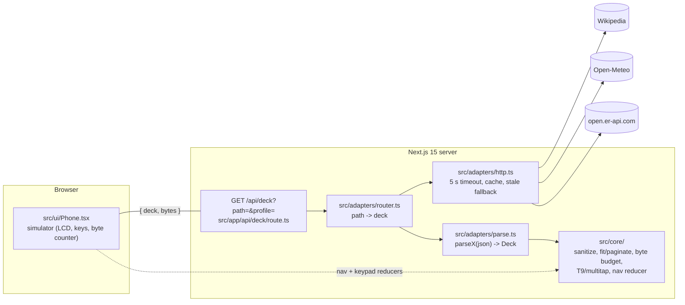

# Revenant

Revenant brings back WAP, the 1999 Wireless Application Protocol that served tiny text "decks of cards" to feature phones. It runs that idea on a modern engine. A server-side transcoder turns today's web content (Wikipedia, weather, exchange rates) into small, cheap-to-load cards. The browser shows them in a feature-phone simulator with an LCD, softkeys, a 5-way pad and a T9 keypad.

Built for Kiroween 2026 (Resurrection category).

## Who it's for

Feature-phone users in Uganda and East Africa who pay for data by the MB. Every screen shows how many bytes the last deck cost.

## Features

1. **Wikipedia:** search with T9 or multitap typing, then read an article page by page.
2. **Weather:** Open-Meteo current conditions and a 3-day forecast for Kampala, Gulu, Mbarara and Jinja.
3. **Money:** UGX per USD, EUR, GBP and KES, with an "as of" time.
4. **Ask:** type a question and get a 3-card answer from the top Wikipedia article summary, labeled with its source.
5. **Settings:** device profile, either Nokia 3310 (14x6 characters) or Generic (20x10).
6. **About:** attribution cards.

## Architecture



`src/core` is pure logic with no fetch, React or Next imports, and ESLint enforces that. Adapters fetch, sanitize and parse. The UI talks only to `/api/deck`.

## Run locally

Requires Node 24.x.

```sh
npm install
cp .env.example .env.local   # set REVENANT_CONTACT (sent in the Wikimedia User-Agent)
npm run dev                  # http://localhost:3000
```

Checks: `npm run typecheck && npm run lint && npm test && npm run build`.

Keyboard: arrow keys for the 5-way pad, Enter = Select, Backspace/Escape = Back, and 0-9, `*`, `#` for the keypad. `#` toggles between T9 and multitap.

## Hosted

Not deployed yet.

## Attribution

- Text from Wikipedia, CC BY-SA 4.0. Each article card shows its source title.
- Weather data by [Open-Meteo.com](https://open-meteo.com/), CC BY 4.0.
- Rates by [Exchange Rate API](https://www.exchangerate-api.com) (open.er-api.com).

## Limitations

- The byte counter shows the real uncompressed UTF-8 size of the `/api/deck` response body. Bytes on the wire differ because of gzip/brotli, HTTP headers and TLS. Back-navigation served from the client cache shows 0 B.
- The output is JSON rendered by a simulator. It is not real WML, and no real WAP phone can load it.
- Only English Wikipedia. Article titles are capped at 60 characters (with a visible "~"), and typed input at 40.
- Caches live in server memory. On serverless hosting they reset on cold starts, so the "offline" stale fallback works only while an instance stays warm.
- Free upstream APIs have rate limits. When an upstream fails and nothing is cached, you get an error deck.
- Tested with unit and property tests only. There are no browser end-to-end tests.

## Originality

All application code in this repo was written for this project with Kiro. Third-party pieces:

- Frameworks: [Next.js 15](https://nextjs.org/) (App Router), [React 19](https://react.dev/), [Tailwind CSS v4](https://tailwindcss.com/).
- Language and tooling: TypeScript 5, ESLint 9 with `eslint-config-next`.
- Testing: [Vitest](https://vitest.dev/), [fast-check](https://fast-check.dev/) (property tests).
- Data: Wikipedia REST/Action APIs, Open-Meteo, open.er-api.com. No API keys, database or accounts.

## License

MIT
